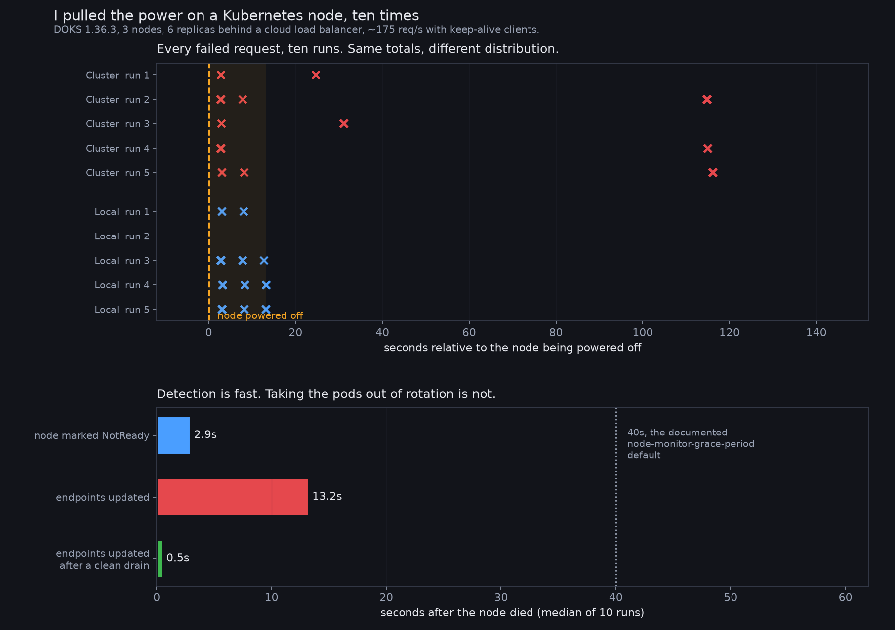

# node-death-timings

What actually happens when a Kubernetes worker node dies without warning. Ten hard
power-offs on DOKS 1.36.3, three nodes, six replicas behind a cloud load balancer,
about 175 requests per second from keep-alive clients.



## The timings, median of ten runs

| | |
|---|---|
| node marked `NotReady` | **2.9s** |
| its pods removed from the Service endpoints | **13.2s** |
| endpoints updated after a clean `kubectl drain` | **0.5s** |

The documented `node-monitor-grace-period` default is 40s and gets quoted constantly.
Detection was more than ten times faster than that. The slow part is not noticing the
node is gone, it is taking its pods out of rotation, and the ten-second gap between
those two events is where every failure lives.

A clean drain removes the endpoints in half a second, **26 times faster** than the
unplanned case.

## externalTrafficPolicy made no difference to how much you lose

This is the part I got wrong. I expected `Local` to cut the damage, and after three
runs it looked like it had. At five runs per policy the totals are identical:

| | total failures per run | median |
|---|---|---|
| `Cluster` (default) | 10, 18, 7, 11, 9 | **10** |
| `Local` | 3, 0, 11, 10, 11 | **10** |

What changes is **when** you lose them:

| | failures within 60s of the kill | later bursts |
|---|---|---|
| `Cluster` | 10, 4, 7, 4, 3  (median 4) | **3 of 5 runs** |
| `Local` | 3, 0, 11, 10, 11  (median 10) | **0 of 5 runs** |

`Local` takes the whole hit immediately, in a tight window, and then it is over.
`Cluster` takes a smaller initial hit and then produces further bursts a minute or
two later, in three runs out of five. Same total, different shape.

## One thing I cannot explain

The later bursts under `Cluster` are 6 to 14 failures inside 0.1 seconds, with every
client thread failing at once, while node readiness and the endpoint list are both
completely unchanged. No node was replaced; all three were the same age afterwards.
Twenty threads failing simultaneously against a stable cluster points somewhere in the
load balancer path rather than at the node loss, and I did not chase it further. The
raw data is in `out/*/failures.json` if you want to.

## Reproducing

```bash
doctl kubernetes cluster create nodekill --region fra1 \
  --node-pool "name=pool;size=s-2vcpu-2gb;count=3;auto-scale=false" --wait
kubectl create configmap appsrc --from-file=server.py
kubectl apply -f base.yaml
kubectl get svc web -o jsonpath='{.status.loadBalancer.ingress[0].ip}' > lb_ip
./kill_test.sh T1 poweroff 180 30     # hard power-off
./kill_test.sh T3 drain    180 30     # clean drain, for comparison
python3 analyse.py
```

Force an even pod spread before measuring. My first run put all six replicas on one
node, which makes it a total-outage test rather than a node-loss test, and my second
had a 3/3/0 split which made the comparison unfair. Both are discarded.

The whole thing cost about 25 cents of cluster time. **Delete the load balancer as
well as the cluster**; a `type: LoadBalancer` Service provisions a separate billable
object.

MIT licensed.
